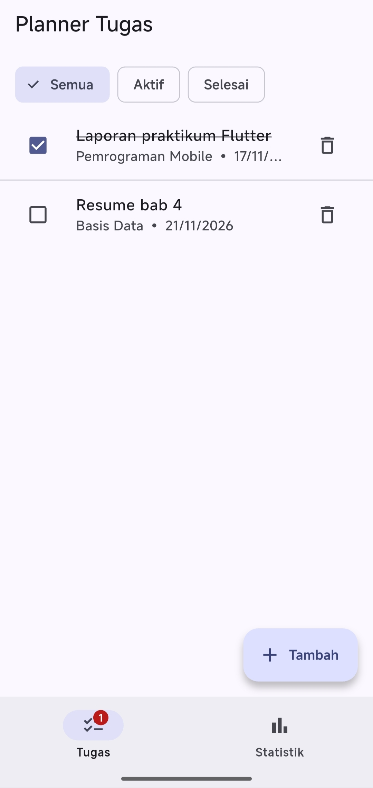
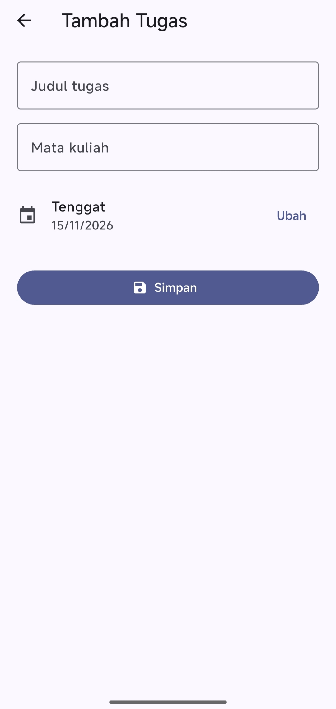
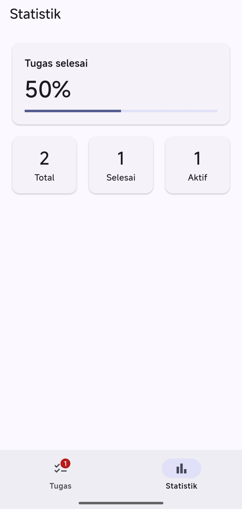
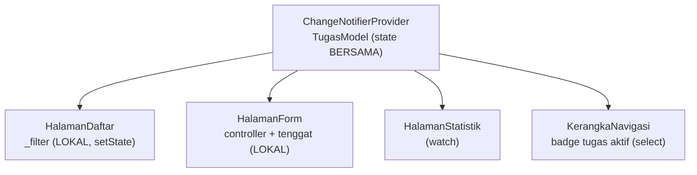

# Planner Tugas Kuliah (Tugas Rutin 7 - Pemrograman Mobile)

## A. Identitas
- Nama: Adinda Soleha
- NIM: 4242550001
- Kelas: PSIK 24D
- Matakuliah: Pemrograman Mobile

## B. Tangkapan Layar
| Daftar tugas | Form tambah tugas | Statistik |
|---|---|---|
|  |  |  |

## C. Letak State


| State | Jenis | Lokasi | Alasan |
|---|---|---|---|
| Daftar tugas | Bersama (app state) | `TugasModel` di atas pohon widget | Dibaca/diubah oleh daftar, form, statistik, dan badge navigasi; harus bertahan saat pindah halaman |
| Filter Semua/Aktif/Selesai | Lokal (ephemeral) | `_HalamanDaftarState` | Hanya dipakai halaman daftar; cukup `setState` |
| Isi kolom form dan tenggat terpilih | Lokal (ephemeral) | `_HalamanFormState` | Hanya relevan selama form terbuka; controller dibuat di `initState`, dibuang di `dispose` |

## D. Lifecycle dan Pilihan State Management
(Draf ±170 kata; sesuaikan dengan kata-kata Anda sendiri, target 150-250 kata.)

Aplikasi ini memakai dua jenis state. Filter Semua/Aktif/Selesai adalah ephemeral state karena hanya dipakai halaman daftar, sehingga cukup disimpan di _HalamanDaftarState dengan setState. Daftar tugas adalah app state karena dibaca dan diubah oleh tiga halaman (daftar, form, statistik) dan badge di navigasi, jadi saya menempatkannya di TugasModel (ChangeNotifier) yang disediakan ChangeNotifierProvider di atas pohon widget. Saya memilih Provider daripada Cubit karena kebutuhan state hanya satu daftar dengan tiga operasi (tambah, tandai selesai, hapus), sehingga ChangeNotifier lebih ringkas dan tetap mudah diuji dengan unit test tanpa UI. Pada halaman form saya memakai lifecycle StatefulWidget: dua TextEditingController dibuat di initState dan dibuang di dispose agar tidak terjadi kebocoran memori. Setelah await showDatePicker, saya memeriksa mounted sebelum setState karena halaman bisa saja sudah ditutup. Di build, saya memakai context.watch pada halaman daftar dan statistik agar ikut berubah, context.read di callback tombol, dan context.select pada badge navigasi agar hanya dibangun ulang ketika jumlah tugas aktif berubah.

## E. Pernyataan Penggunaan AI
Kerangka kode aplikasi ini (struktur proyek, model TugasKuliah dan TugasModel, konfigurasi go_router, halaman daftar, form, dan statistik, unit test, serta draf README) dibuat dengan bantuan Claude. Saya mempelajari kode tersebut, menjalankannya, menguji alurnya secara manual (tambah, tandai selesai, hapus, dan filter), serta menjalankan flutter analyze dan flutter test. Saya juga menyesuaikan isi README, termasuk penjelasan lifecycle dengan kata-kata saya sendiri. 

## Menjalankan
```
flutter pub get
flutter run
flutter test
flutter analyze
```
